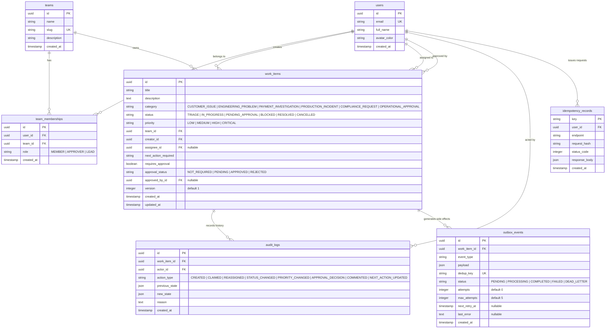
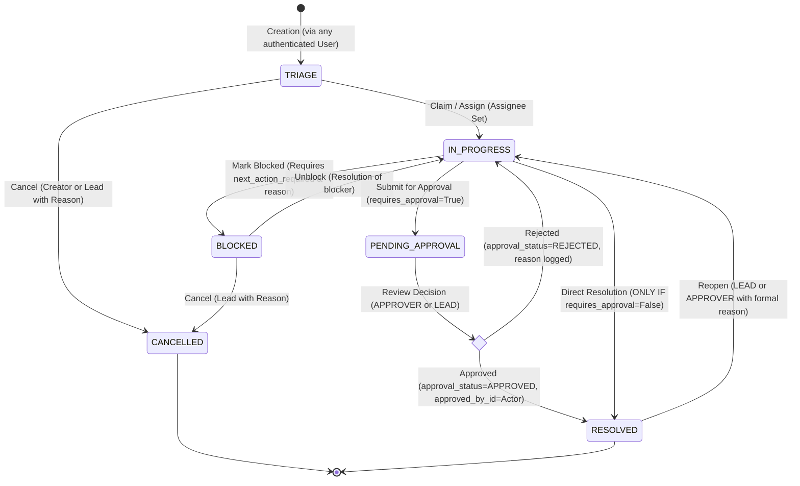
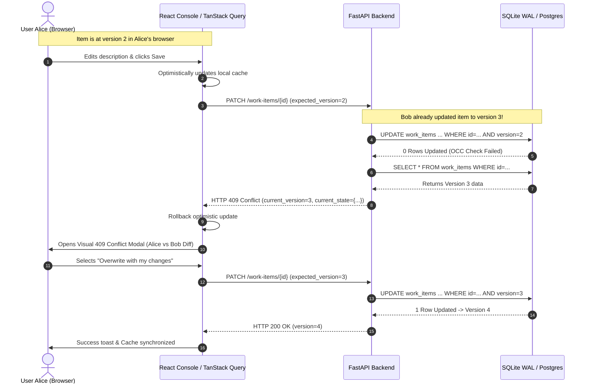

# Master Architecture Specification: Newtonite Operations Platform
**Document Version:** 1.0.0-LOCKED  
**Methodology Stage:** M — Master Architecture (MAPE Framework)  
**System Classification:** High-Integrity Distributed Operations Management Engine  
**Author:** Principal Systems Architect

---

## 1. Executive Summary & Problem Framing

### 1.1 The Operational Crisis
Modern organizations operating with hundreds of employees inevitably hit the "coordination wall" when relying on informal channels (Slack, spreadsheets, email, ad-hoc tickets). This operating mode suffers from six critical systemic failure modes:
1. **The Stale-Read Lost-Update Problem:** User A views a ticket at version 1; User B changes the status to `RESOLVED` at version 2; User A submits an edit based on stale context, blindly overwriting User B's resolution.
2. **The Simultaneous Claim Collision:** Two triage engineers notice a critical customer incident at the exact same moment. Both click "Assign to me". Without atomic serialization, race conditions lead to duplicate investigation, contradictory customer communication, and wasted engineering hours.
3. **Ghost Actions & Silent Drifts:** Critical items move through approval gates or change priority without a cryptographically reliable, immutable audit trail. When an incident is dropped or an unapproved configuration deployed, root cause analysis fails due to absent provenance.
4. **Network Duplicate Ingestion:** Operational engineers in transit or under high packet-loss conditions submit urgent approvals or status updates multiple times when a UI spinner hangs, generating duplicate downstream workflows or corrupting state machines.
5. **Dual-Write Distributed Inconsistency:** Updates that attempt to mutate the primary operational database and trigger downstream external actions (Slack alerts, compliance webhooks) fail partially. When an external network call fails after DB commit, secondary actions are lost; when DB commit fails after external notification, phantom alerts are dispatched.
6. **Query Starvation at Scale:** As the volume of historical records climbs past tens of thousands of work items, naive architectures that dump entire tables to the client browser degrade CPU memory and freeze browser main threads.

### 1.2 Architectural Scope & Objectives
The Newtonite Operations Platform resolves these failure modes through a deterministic, high-concurrency architecture that prioritizes **correctness over naive CRUD simplicity**. The system guarantees:
- **Zero Lost Updates:** Enforced via atomic database-level Optimistic Concurrency Control (OCC).
- **Zero Race-Condition Collisions:** Enforced via conditional atomic SQL row claims.
- **Strict Single-Execution Semantics:** Enforced via synchronous database-backed Idempotency Keys.
- **Zero Audit Drift:** Guaranteed via synchronous ACID transactions binding state mutations to immutable audit logs.
- **Resilient Secondary Side Effects:** Guaranteed via a Transactional Outbox Pattern with at-least-once delivery, exponential backoff, and dead-letter queues.
- **Strict Role-Gated State Transitions:** Decoupled RBAC enforced at the domain service layer, preventing bypass via direct API manipulation.

---

## 2. Tech Stack & Runtime Topology

### 2.1 Technology Stack Rationale

| Layer | Selected Technology | Version | Architectural Rationale |
| :--- | :--- | :--- | :--- |
| **Backend Runtime** | Python | 3.11+ | Native asynchronous task support, exception groups, strong typing syntax, performance enhancements over 3.10. |
| **API Framework** | FastAPI | 0.110+ | Asynchronous event loop native (`async`/`await`), automatic OpenAPI 3.1 generation, native Pydantic v2 deep integration for schema validation. |
| **ORM / Data Access** | SQLAlchemy (Async) | 2.0+ | Modern 2.0-style declarative async querying, strict type checking, explicit transaction boundaries (`session.begin()`), preventing accidental lazy loading leaks. |
| **Data Validation** | Pydantic | v2.6+ | Rust-backed core validation for sub-millisecond serialization/deserialization, strict type constraints, deterministic JSON schema exports. |
| **Local / Test Database** | SQLite (WAL Mode) | 3.42+ | Zero external dependency setup for local evaluation. Configured with Write-Ahead Logging (`PRAGMA journal_mode=WAL; PRAGMA busy_timeout=5000;`) ensuring concurrent readers never block concurrent writers. |
| **Production Database** | PostgreSQL | 15+ | Seamless migration via uniform SQLAlchemy dialect abstraction, supporting row-level locking and native JSONB indexing. Configurable via `DATABASE_URL`. |
| **Frontend Runtime** | React | 18.2+ | Concurrent rendering, declarative component tree, standardized ecosystem. |
| **Language** | TypeScript | 5.3+ | Strict null checking, end-to-end type sharing with backend API contracts, eliminating runtime type errors. |
| **Build Tooling** | Vite | 5.0+ | Instant Hot Module Replacement (HMR), tree-shaken production bundles, zero-friction build pipeline. |
| **Styling** | Vanilla CSS + Tailwind CSS | 3.4+ | Utility-first responsive design, predictable cascade, zero runtime CSS-in-JS overhead. |
| **Server State Management** | TanStack Query | v5+ | Declarative query caching, automatic background revalidation, optimistic update mutations, robust rollback capabilities on HTTP 409 conflicts. |
| **Icons & Design Tokens** | Lucide React | Latest | Consistent semantic iconography for operational statuses, priorities, and workflow actions. |

### 2.2 System Runtime Topology Diagram

```mermaid
flowchart TB
    subgraph ClientBrowser["Client Tier: Operations Console (React 18 / Vite / TS)"]
        UI[Operational Dashboard & Triage Grid]
        TQ[TanStack Query v5 Cache & Mutation Engine]
        DIFF[Visual 409 Conflict Reconciliation Modal]
        UI <--> TQ
        TQ <--> DIFF
    end

    subgraph APIGateway["Application Tier: FastAPI (Python 3.11 Async)"]
        AUTH[Auth & Tenant Middleware: X-User-Id / Team Scoping]
        IDEMP[Idempotency Guard Middleware]
        CTRL[Domain Controllers / Routers]
        SVC[Operational Domain Service & State Machine]
        OCC[OCC & Versioning Engine]
        AUDIT[Synchronous Audit Emitter]
        
        AUTH --> IDEMP --> CTRL --> SVC
        SVC --> OCC
        SVC --> AUDIT
    end

    subgraph PersistenceTier["Storage Tier (SQLite WAL Mode / PostgreSQL 15)"]
        DB[(Primary Relational Storage)]
        subgraph Tables["ACID Transaction Boundary"]
            TBL_WORK[work_items]
            TBL_AUDIT[audit_logs]
            TBL_IDEMP[idempotency_records]
            TBL_OUTBOX[outbox_events]
            TBL_TEAMS[teams & team_memberships]
            TBL_USERS[users]
        end
        OCC -.->|Atomic Update| TBL_WORK
        AUDIT -.->|Atomic Insert| TBL_AUDIT
        IDEMP -.->|Read / Write| TBL_IDEMP
        SVC -.->|Atomic Event Insert| TBL_OUTBOX
    end

    subgraph AsyncWorkerTier["Background Asynchronous Worker Tier"]
        POLLER[Transactional Outbox Poller / Dispatcher]
        HANDLERS[Idempotent Event Handlers: Notifications / Webhooks]
        DLQ[Dead Letter Queue Handler]
        
        POLLER -->|Read Pending & Update Claim| TBL_OUTBOX
        POLLER --> HANDLERS
        HANDLERS -.->|Retry on Failure (Max 5)| POLLER
        HANDLERS -->|Exceeded Max Attempts| DLQ
    end

    ClientBrowser <-->|HTTP/REST with Headers: Idempotency-Key, X-User-Id| APIGateway
    APIGateway <-->|SQLAlchemy Async Engine / Pool| PersistenceTier
```

---

## 3. Entity-Relationship & Relational Data Model Specification

### 3.1 Database Schemas & Constraints

The relational schema is built with defensive integrity: foreign keys are indexed, unique constraints prevent duplicate state records, and append-only audit structures prevent any historical tampering.



### 3.2 SQL DDL (PostgreSQL & SQLite WAL Compatible)

```sql
-- Core Extensions (PostgreSQL)
-- CREATE EXTENSION IF NOT EXISTS "uuid-ossp";

-- 1. Users Table
CREATE TABLE users (
    id VARCHAR(36) PRIMARY KEY,
    email VARCHAR(255) NOT NULL UNIQUE,
    full_name VARCHAR(255) NOT NULL,
    avatar_color VARCHAR(32) NOT NULL DEFAULT '#6366F1',
    created_at TIMESTAMP WITH TIME ZONE NOT NULL DEFAULT CURRENT_TIMESTAMP
);

-- 2. Teams Table
CREATE TABLE teams (
    id VARCHAR(36) PRIMARY KEY,
    name VARCHAR(255) NOT NULL,
    slug VARCHAR(100) NOT NULL UNIQUE,
    description TEXT NOT NULL DEFAULT '',
    created_at TIMESTAMP WITH TIME ZONE NOT NULL DEFAULT CURRENT_TIMESTAMP
);

-- 3. Team Memberships Table
CREATE TABLE team_memberships (
    id VARCHAR(36) PRIMARY KEY,
    user_id VARCHAR(36) NOT NULL REFERENCES users(id) ON DELETE CASCADE,
    team_id VARCHAR(36) NOT NULL REFERENCES teams(id) ON DELETE CASCADE,
    role VARCHAR(32) NOT NULL CHECK (role IN ('MEMBER', 'APPROVER', 'LEAD')),
    created_at TIMESTAMP WITH TIME ZONE NOT NULL DEFAULT CURRENT_TIMESTAMP,
    CONSTRAINT uq_team_membership UNIQUE (user_id, team_id)
);
CREATE INDEX idx_team_memberships_user ON team_memberships(user_id);
CREATE INDEX idx_team_memberships_team ON team_memberships(team_id);

-- 4. Work Items Table
CREATE TABLE work_items (
    id VARCHAR(36) PRIMARY KEY,
    title VARCHAR(255) NOT NULL,
    description TEXT NOT NULL,
    category VARCHAR(64) NOT NULL CHECK (category IN (
        'CUSTOMER_ISSUE', 
        'ENGINEERING_PROBLEM', 
        'PAYMENT_INVESTIGATION', 
        'PRODUCTION_INCIDENT', 
        'COMPLIANCE_REQUEST', 
        'OPERATIONAL_APPROVAL'
    )),
    status VARCHAR(32) NOT NULL DEFAULT 'TRIAGE' CHECK (status IN (
        'TRIAGE', 
        'IN_PROGRESS', 
        'PENDING_APPROVAL', 
        'BLOCKED', 
        'RESOLVED', 
        'CANCELLED'
    )),
    priority VARCHAR(32) NOT NULL DEFAULT 'MEDIUM' CHECK (priority IN (
        'LOW', 
        'MEDIUM', 
        'HIGH', 
        'CRITICAL'
    )),
    team_id VARCHAR(36) NOT NULL REFERENCES teams(id) ON DELETE RESTRICT,
    creator_id VARCHAR(36) NOT NULL REFERENCES users(id) ON DELETE RESTRICT,
    assignee_id VARCHAR(36) NULL REFERENCES users(id) ON DELETE SET NULL,
    next_action_required VARCHAR(500) NOT NULL DEFAULT 'Initial triage required',
    requires_approval BOOLEAN NOT NULL DEFAULT FALSE,
    approval_status VARCHAR(32) NOT NULL DEFAULT 'NOT_REQUIRED' CHECK (approval_status IN (
        'NOT_REQUIRED', 
        'PENDING', 
        'APPROVED', 
        'REJECTED'
    )),
    approved_by_id VARCHAR(36) NULL REFERENCES users(id) ON DELETE SET NULL,
    version INTEGER NOT NULL DEFAULT 1,
    created_at TIMESTAMP WITH TIME ZONE NOT NULL DEFAULT CURRENT_TIMESTAMP,
    updated_at TIMESTAMP WITH TIME ZONE NOT NULL DEFAULT CURRENT_TIMESTAMP
);

-- Scale Indexes: High query volume routing & triage optimization
CREATE INDEX idx_work_items_team_status_prio ON work_items(team_id, status, priority);
CREATE INDEX idx_work_items_assignee_status ON work_items(assignee_id, status);
CREATE INDEX idx_work_items_pagination ON work_items(updated_at DESC, id DESC);
CREATE INDEX idx_work_items_category ON work_items(category);

-- 5. Audit Logs Table (Append-Only)
CREATE TABLE audit_logs (
    id VARCHAR(36) PRIMARY KEY,
    work_item_id VARCHAR(36) NOT NULL REFERENCES work_items(id) ON DELETE CASCADE,
    actor_id VARCHAR(36) NOT NULL REFERENCES users(id) ON DELETE RESTRICT,
    action_type VARCHAR(64) NOT NULL CHECK (action_type IN (
        'CREATED', 
        'CLAIMED', 
        'REASSIGNED', 
        'STATUS_CHANGED', 
        'PRIORITY_CHANGED', 
        'APPROVAL_DECISION', 
        'COMMENTED', 
        'NEXT_ACTION_UPDATED'
    )),
    previous_state TEXT NOT NULL DEFAULT '{}', -- Stored as JSON string
    new_state TEXT NOT NULL DEFAULT '{}',      -- Stored as JSON string
    reason TEXT NOT NULL DEFAULT '',
    created_at TIMESTAMP WITH TIME ZONE NOT NULL DEFAULT CURRENT_TIMESTAMP
);
CREATE INDEX idx_audit_logs_item_created ON audit_logs(work_item_id, created_at DESC);
CREATE INDEX idx_audit_logs_actor ON audit_logs(actor_id);

-- 6. Idempotency Records Table
CREATE TABLE idempotency_records (
    key VARCHAR(255) PRIMARY KEY,
    user_id VARCHAR(36) NOT NULL REFERENCES users(id) ON DELETE CASCADE,
    endpoint VARCHAR(255) NOT NULL,
    request_hash VARCHAR(64) NOT NULL,
    status_code INTEGER NOT NULL,
    response_body TEXT NOT NULL, -- Stored as JSON string
    created_at TIMESTAMP WITH TIME ZONE NOT NULL DEFAULT CURRENT_TIMESTAMP
);
CREATE INDEX idx_idempotency_user ON idempotency_records(user_id);
CREATE INDEX idx_idempotency_created ON idempotency_records(created_at);

-- 7. Outbox Events Table (Transactional Outbox)
CREATE TABLE outbox_events (
    id VARCHAR(36) PRIMARY KEY,
    work_item_id VARCHAR(36) NOT NULL REFERENCES work_items(id) ON DELETE CASCADE,
    event_type VARCHAR(64) NOT NULL,
    payload TEXT NOT NULL,       -- Stored as JSON string
    dedup_key VARCHAR(255) NOT NULL UNIQUE,
    status VARCHAR(32) NOT NULL DEFAULT 'PENDING' CHECK (status IN (
        'PENDING', 
        'PROCESSING', 
        'COMPLETED', 
        'FAILED', 
        'DEAD_LETTER'
    )),
    attempts INTEGER NOT NULL DEFAULT 0,
    max_attempts INTEGER NOT NULL DEFAULT 5,
    next_retry_at TIMESTAMP WITH TIME ZONE NULL,
    last_error TEXT NULL,
    created_at TIMESTAMP WITH TIME ZONE NOT NULL DEFAULT CURRENT_TIMESTAMP
);
CREATE INDEX idx_outbox_processing ON outbox_events(status, next_retry_at, created_at);
```

---

## 4. Explicit State Machine & Approval Matrix

### 4.1 State Machine Lifecycle Diagram

The state machine strictly prevents arbitrary status jumps. Every transition requires validation against business invariants and role authorizations.



### 4.2 State Transition Matrix & Invariants

| Origin State | Destination State | Invariant Guard Conditions | Required Role | Mandatory Audit Requirement |
| :--- | :--- | :--- | :--- | :--- |
| *None* | `TRIAGE` | System allocates `version=1`, `approval_status='NOT_REQUIRED'` (or `'PENDING'` if `requires_approval=True`). | Any authenticated user | Action `CREATED` |
| `TRIAGE` | `IN_PROGRESS` | `assignee_id` MUST be populated. Cannot be claimed if already assigned without explicit unassignment. | `MEMBER`, `APPROVER`, `LEAD` | Action `CLAIMED` or `STATUS_CHANGED` |
| `TRIAGE` | `CANCELLED` | Item not actionable or duplicate. | Creator or `LEAD` | Action `STATUS_CHANGED` + mandatory reason |
| `IN_PROGRESS` | `BLOCKED` | `next_action_required` must document the external impediment. | Assignee, `MEMBER`, `LEAD` | Action `STATUS_CHANGED` + blocker details |
| `BLOCKED` | `IN_PROGRESS` | Blocker cleared. | Assignee, `MEMBER`, `LEAD` | Action `STATUS_CHANGED` |
| `IN_PROGRESS` | `PENDING_APPROVAL`| `requires_approval == True`. Sets `approval_status = 'PENDING'`. | Assignee, `MEMBER`, `LEAD` | Action `STATUS_CHANGED` |
| `PENDING_APPROVAL` | `RESOLVED` | **CRITICAL INVARIANT:** Must be transitioned via explicit `/approve` action. Actor role in owning `team_id` MUST be `APPROVER` or `LEAD`. Sets `approval_status = 'APPROVED'`, `approved_by_id = actor.id`. | `APPROVER` or `LEAD` | Action `APPROVAL_DECISION` + decision reason |
| `PENDING_APPROVAL` | `IN_PROGRESS` | Approval rejected. Sets `approval_status = 'REJECTED'`. | `APPROVER` or `LEAD` | Action `APPROVAL_DECISION` + rejection reason |
| `IN_PROGRESS` | `RESOLVED` | **CRITICAL INVARIANT:** Permitted **ONLY IF** `requires_approval == False`. If `requires_approval == True`, transition is rejected with `422 Unprocessable Entity`. | Assignee or `LEAD` | Action `STATUS_CHANGED` + resolution note |
| `RESOLVED` | `IN_PROGRESS` | Regression or incomplete fix. Increments `version`. | `LEAD` or `APPROVER` | Action `STATUS_CHANGED` + reopening justification |
| Any (except `RESOLVED`) | `CANCELLED` | Work invalidated. Sets terminal state. | `LEAD` (or Creator if still in `TRIAGE`) | Action `STATUS_CHANGED` + mandatory reason |

---

## 5. Resource-Level RBAC Matrix

Authorization in the Newtonite Operations Platform is evaluated at the **resource boundary**, checking the caller's specific membership role within the team that owns the work item (`team_id`).

### 5.1 Role Hierarchy within Owning Team
- **`NON_MEMBER`**: An authenticated user who does not belong to the work item's owning team.
- **`MEMBER`**: Standard operational contributor in the owning team.
- **`APPROVER`**: Senior team contributor authorized to inspect, certify, approve, and resolve high-risk operational items.
- **`LEAD`**: Team administrator with administrative authority (force reassignment, priority override, reopening, work cancellation).

### 5.2 Permission Enforcement Matrix

| Capability / Action | NON_MEMBER | MEMBER | APPROVER | LEAD | System Enforcement Rule |
| :--- | :---: | :---: | :---: | :---: | :--- |
| **View Work Item & Audit History** | Allowed | Allowed | Allowed | Allowed | Internal transparency: all company employees can inspect operational status to eliminate duplicate filing. |
| **Create Work Item for Team** | Allowed | Allowed | Allowed | Allowed | Cross-department requests: any employee can request work from another team (e.g. Sales -> Engineering). |
| **Claim Unassigned Item** | Denied | **Allowed** | **Allowed** | **Allowed** | Only team members can claim ownership to work the queue. |
| **Self-Assign / Release** | Denied | **Allowed** | **Allowed** | **Allowed** | Member can assign to self or release to unassigned if currently assigned to them. |
| **Force-Reassign to Colleague** | Denied | Denied | Denied | **Allowed** | Only `LEAD` can reassign an item between other members without their consent. |
| **Update `next_action_required`** | Denied | **Allowed** (Assignee) | **Allowed** | **Allowed** | Assignee or team supervisor can update operational attention notes. |
| **Change Priority** | Denied | Denied | **Allowed** | **Allowed** | Prevents priority inflation by requesters. High/Critical assignments require approval authority. |
| **Transition to `BLOCKED` / `IN_PROGRESS`**| Denied | **Allowed** (Assignee) | **Allowed** | **Allowed** | Daily workflow state management. |
| **Submit for Approval** | Denied | **Allowed** (Assignee) | **Allowed** | **Allowed** | Prepares item for certification. |
| **Approve Item (`-> RESOLVED`)** | **Denied** | **Denied** | **Allowed** | **Allowed** | **Hard Invariant:** Backend rejects call if actor is not `APPROVER` or `LEAD` on `work_item.team_id`. |
| **Reject Item (`-> IN_PROGRESS`)** | **Denied** | **Denied** | **Allowed** | **Allowed** | Rejects item back to assignee with feedback. |
| **Resolve (`requires_approval=False`)**| Denied | **Allowed** (Assignee) | **Allowed** | **Allowed** | Direct resolution permitted only for standard items. |
| **Reopen `RESOLVED` Item** | Denied | Denied | **Allowed** | **Allowed** | Prevents casual reopening without supervisory review. |
| **Cancel Work Item** | Creator (in `TRIAGE` only) | Denied | Denied | **Allowed** | Lead can cancel at any stage; creator only if untouched. |

---

## 6. The 6 Beyond-CRUD Correctness Protocols

The core architecture is anchored by 6 explicit correctness protocols designed to survive concurrency, network failure, and human error.

### 6.1 Protocol 1: Optimistic Concurrency Control (OCC)
- **Problem:** Two users open the same high-severity ticket. User A updates the description. User B changes the priority to `CRITICAL`. If User B's request executes second, User A's changes are lost if naive full-object updates are used.
- **Engineered Solution:**
  1. Every `work_items` row contains an integer `version` field (starts at 1).
  2. Every state-mutating request (`PATCH /work-items/{id}`, status transition, approval) must supply `expected_version` in the payload.
  3. The database execution performs an atomic conditional update:
     ```sql
     UPDATE work_items
     SET 
         title = :title,
         description = :description,
         priority = :priority,
         next_action_required = :next_action_required,
         version = version + 1,
         updated_at = CURRENT_TIMESTAMP
     WHERE id = :id AND version = :expected_version
     RETURNING *;
     ```
  4. If `ROWCOUNT == 0`, a concurrent update occurred. The transaction rolls back.
  5. The API fetches the latest committed row from the database and returns HTTP `409 Conflict`:
     ```json
     {
       "error_code": "CONCURRENCY_CONFLICT",
       "message": "The work item was updated by another user while you were editing.",
       "current_version": 4,
       "expected_version": 3,
       "current_state": {
         "id": "c1f7b820-8022-4a0b-8d8d-8a1a3e6a9f01",
         "title": "Payment webhook timeouts",
         "status": "IN_PROGRESS",
         "priority": "CRITICAL",
         "version": 4,
         "updated_at": "2026-10-20T01:10:00Z"
       }
     }
     ```

### 6.2 Protocol 2: Simultaneous Claim Protection
- **Problem:** When an urgent production incident enters `TRIAGE`, multiple on-call engineers attempt to claim it at the same moment.
- **Engineered Solution:**
  1. The claim endpoint (`POST /work-items/{id}/claim`) executes an atomic, conditional assignment:
     ```sql
     UPDATE work_items
     SET 
         assignee_id = :user_id,
         status = CASE WHEN status = 'TRIAGE' THEN 'IN_PROGRESS' ELSE status END,
         version = version + 1,
         updated_at = CURRENT_TIMESTAMP
     WHERE id = :id 
       AND version = :expected_version 
       AND assignee_id IS NULL
     RETURNING *;
     ```
  2. If the row cannot be updated because `assignee_id IS NOT NULL`, the system inspects the existing row:
     - Returns HTTP `409 Conflict` with code `ALREADY_CLAIMED`.
     - Payload includes the winning claimant's identity:
       ```json
       {
         "error_code": "ALREADY_CLAIMED",
         "message": "This work item has already been claimed by another team member.",
         "claimed_by": {
           "id": "e3b0c442-98fc-1c14-9afbf4c8996fb924",
           "full_name": "Sarah Connor",
           "email": "sconnor@newtonite.internal"
         },
         "current_version": 3
       }
       ```
  3. No race condition can result in dual ownership.

### 6.3 Protocol 3: Synchronous Idempotency Guard
- **Problem:** An engineer clicks "Approve & Resolve" during network jitter. The browser spinner halts; the engineer clicks again. Without idempotency, duplicate side effects, duplicate audit rows, and corrupted state transitions occur.
- **Engineered Solution:**
  1. All mutating operations (`POST`, `PATCH`, `/claim`, `/approve`, `/transition`) accept a mandatory or client-generated `Idempotency-Key: <UUID>` HTTP header.
  2. The request enters the `IdempotencyMiddleware`:
     - Computes SHA-256 hash of: `user_id + endpoint + request_payload`.
     - Queries `idempotency_records WHERE key = :key`.
  3. **Case A (Exact Replay):** Record exists and `request_hash` matches. The middleware short-circuits the pipeline and immediately returns the cached `status_code` and `response_body` with response header `X-Cache-Lookup: HIT`.
  4. **Case B (Key Reused with Different Payload):** Record exists but `request_hash` differs. The middleware returns HTTP `422 Unprocessable Entity` with `IDEMPOTENCY_KEY_REUSED_WITH_DIFFERENT_PAYLOAD`.
  5. **Case C (First Execution):** The request proceeds. Inside the **same database transaction** as the business logic, the new `idempotency_records` entry is committed.

### 6.4 Protocol 4: Synchronous Transactional Audit Logging
- **Problem:** If audit logging is performed asynchronously (e.g. fire-and-forget background tasks), worker crashes or queue drops cause state to change without historical records, violating compliance and preventing forensic debugging.
- **Engineered Solution:**
  1. In the domain service, every mutation is packaged alongside an `audit_logs` record inside a single atomic `session.begin()` block:
     ```python
     async with session.begin():
         # 1. Update WorkItem with OCC check
         # 2. Insert AuditLog record
         audit = AuditLog(
             id=str(uuid4()),
             work_item_id=item.id,
             actor_id=current_user.id,
             action_type=action_type,
             previous_state=old_state_dict,
             new_state=new_state_dict,
             reason=reason
         )
         session.add(audit)
         # Commit handles both atomically
     ```
  2. If the audit insert fails (e.g. disk full, foreign key constraint), the work item mutation rolls back entirely.
  3. **Result:** Cryptographic 1:1 invariant between state changes and audit trail entries.

### 6.5 Protocol 5: Reliable Asynchronous Processing via Transactional Outbox
- **Problem:** Secondary side effects (emailing the compliance lead, dispatching on-call webhooks, syncing search indexes) must not slow down the synchronous HTTP request or risk dual-write inconsistency if the network fails.
- **Engineered Solution:**
  1. When a work item mutation occurs, an `outbox_events` row is written inside the **same ACID transaction** as the work item and audit log.
  2. The row contains: `dedup_key` (e.g., `item-{id}-status-PENDING_APPROVAL-{version}`), `event_type`, `payload`, and `status='PENDING'`.
  3. A background task (`OutboxDispatcher`) continuously polls for pending events:
     ```sql
     -- Atomic claim of pending batch
     UPDATE outbox_events
     SET status = 'PROCESSING'
     WHERE id IN (
         SELECT id FROM outbox_events
         WHERE status IN ('PENDING', 'FAILED')
           AND (next_retry_at IS NULL OR next_retry_at <= CURRENT_TIMESTAMP)
         ORDER BY created_at ASC
         LIMIT 20
     )
     RETURNING *;
     ```
  4. The worker executes the external handler idempotently using `dedup_key`.
  5. **Error & Retry Policy:**
     - If handler succeeds: `status = 'COMPLETED'`.
     - If handler fails: `attempts = attempts + 1`. If `attempts < max_attempts (5)`, status set to `'FAILED'` with exponential backoff:
       $$\text{next\_retry\_at} = \text{now}() + 2^{\text{attempts}} \times 2\text{ seconds}$$
     - If `attempts >= 5`: status set to `'DEAD_LETTER'` with full traceback saved in `last_error`.
  6. **Failure Simulation Hook:** Supports testing via endpoint `POST /api/v1/outbox/simulate-failure` to verify DLQ and exponential backoff behavior on demand.

### 6.6 Protocol 6: Frontend Optimistic State & 409 Conflict Diff/Reconciliation
- **Problem:** Users experience latency when mutating items, but naive optimistic updates silently revert on errors or mask server updates.
- **Engineered Solution:**
  1. The React frontend uses TanStack Query `onMutate`:
     - Snapshot current query cache.
     - Optimistically apply user's intended mutation to the UI grid/detail view.
  2. If backend returns HTTP `409 Conflict`:
     - `onError` catches the conflict and rolls back optimistic cache.
     - Extracts `current_state` and `current_version` from the 409 response payload.
     - Mounts the **Visual 409 Conflict Reconciliation Modal**:
       - Displays a side-by-side field diff: `[Your Change]` vs `[Current Server Reality]`.
       - Clearly highlights which user made the conflicting update and when.
     - **User Reconciliation Actions:**
       - **Action A: "Overwrite with My Changes"** (Re-sends request with `expected_version = current_version`).
       - **Action B: "Discard My Changes & Refresh"** (Accepts server state, updates local cache, closes modal).
       - **Action C: "Selective Merge"** (User chooses field-by-field which values to retain).



---

## 7. REST API Contract Specification

All endpoints adhere to standardized REST conventions, returning structured JSON envelopes and standard HTTP status codes.

### 7.1 Common Request Headers
- `X-User-Id` (UUID, required): Simulated authenticated user context for evaluation & role scoping.
- `Idempotency-Key` (UUID/string, optional for GET, required for all state-mutating POST/PATCH).
- `Content-Type`: `application/json`.

### 7.2 Standard Error Response Envelope
Every non-2xx response follows this uniform schema:
```json
{
  "error_code": "STRING_IDENTIFIER",
  "message": "Human readable summary of the failure",
  "details": {},
  "timestamp": "2026-10-20T01:15:30Z"
}
```

### 7.3 Complete API Route Specifications

#### A. Identity & Team Context
1. **`GET /api/v1/users`**
   - Returns list of all available seeded users for rapid switcher testing.
   - Response: `200 OK` `List[UserResponse]`
2. **`GET /api/v1/users/me`**
   - Returns currently authenticated user context based on `X-User-Id` header with all team memberships.
   - Response: `200 OK` `UserDetailResponse`
3. **`GET /api/v1/teams`**
   - Returns list of all operational teams with membership counts.
   - Response: `200 OK` `List[TeamResponse]`

#### B. Work Item Management
4. **`GET /api/v1/work-items`**
   - Query Parameters:
     - `team_id` (UUID, optional)
     - `status` (`TRIAGE`, `IN_PROGRESS`, `PENDING_APPROVAL`, `BLOCKED`, `RESOLVED`, `CANCELLED`, optional)
     - `priority` (`LOW`, `MEDIUM`, `HIGH`, `CRITICAL`, optional)
     - `category` (enum, optional)
     - `assignee_id` (UUID, optional)
     - `search` (string, optional - searches title & description)
     - `limit` (integer, default 20, max 100)
     - `offset` (integer, default 0)
   - Response: `200 OK`
     ```json
     {
       "items": [
         {
           "id": "c1f7b820-8022-4a0b-8d8d-8a1a3e6a9f01",
           "title": "Payment webhook timeouts",
           "description": "Stripe webhooks failing with 504 gateway timeout",
           "category": "PAYMENT_INVESTIGATION",
           "status": "IN_PROGRESS",
           "priority": "CRITICAL",
           "team_id": "9b1deb4d-3b7d-4bad-9bdd-2b0d7b3dcb6d",
           "creator_id": "a0eebc99-9c0b-4ef8-bb6d-6bb9bd380a11",
           "assignee_id": "e3b0c442-98fc-1c14-9afbf4c8996fb924",
           "next_action_required": "Investigate ingress rate limiters",
           "requires_approval": true,
           "approval_status": "PENDING",
           "approved_by_id": null,
           "version": 3,
           "created_at": "2026-10-20T00:00:00Z",
           "updated_at": "2026-10-20T01:10:00Z"
         }
       ],
       "total": 142,
       "limit": 20,
       "offset": 0
     }
     ```

5. **`POST /api/v1/work-items`**
   - Header: `Idempotency-Key` (required)
   - Request Body:
     ```json
     {
       "title": "Production database replication lag > 300s",
       "description": "Replica node 2 falling behind primary node",
       "category": "PRODUCTION_INCIDENT",
       "priority": "CRITICAL",
       "team_id": "9b1deb4d-3b7d-4bad-9bdd-2b0d7b3dcb6d",
       "requires_approval": true,
       "next_action_required": "Check WAL disk IOPS"
     }
     ```
   - Response: `201 Created` (Returns newly created WorkItem with `version: 1`).

6. **`GET /api/v1/work-items/{id}`**
   - Response: `200 OK` (Full detail including creator, assignee, team object, and approval status).

7. **`PATCH /api/v1/work-items/{id}`**
   - Header: `Idempotency-Key` (required)
   - Request Body:
     ```json
     {
       "expected_version": 2,
       "title": "Production database replication lag > 300s (Stabilizing)",
       "description": "Replica node 2 WAL caught up to 12s",
       "next_action_required": "Monitor next 30 minutes",
       "reason": "Replica recovery observed"
     }
     ```
   - Errors:
     - `409 Conflict` (OCC version mismatch)
     - `403 Forbidden` (User unauthorized)
     - `422 Unprocessable Entity` (Invalid data)

8. **`POST /api/v1/work-items/{id}/claim`**
   - Header: `Idempotency-Key` (required)
   - Request Body:
     ```json
     {
       "expected_version": 2
     }
     ```
   - Behavior: Atomically claims the item for caller `X-User-Id`.
   - Errors:
     - `409 Conflict` with `ALREADY_CLAIMED` if another user claimed first.
     - `409 Conflict` with `CONCURRENCY_CONFLICT` if version mismatch.
     - `403 Forbidden` if user is not `MEMBER`, `APPROVER`, or `LEAD` of owning team.

9. **`POST /api/v1/work-items/{id}/transition`**
   - Header: `Idempotency-Key` (required)
   - Request Body:
     ```json
     {
       "expected_version": 3,
       "target_status": "BLOCKED",
       "next_action_required": "Awaiting Cloud Provider Support Ticket #9812",
       "reason": "AWS network partition confirmed"
     }
     ```
   - Invariants Enforced:
     - Rejects transition to `RESOLVED` if `requires_approval=True`.
     - Validates state machine graph.
     - Emits synchronous `audit_logs` record.

10. **`POST /api/v1/work-items/{id}/approve`**
    - Header: `Idempotency-Key` (required)
    - Request Body:
      ```json
      {
        "expected_version": 4,
        "decision": "APPROVED",
        "reason": "Emergency fix verified in staging; performance benchmarks validated."
      }
      ```
    - Behavior:
      - Validates caller role is `APPROVER` or `LEAD` in `work_item.team_id`.
      - If `decision == 'APPROVED'`: sets `status = 'RESOLVED'`, `approval_status = 'APPROVED'`, `approved_by_id = actor.id`.
      - If `decision == 'REJECTED'`: sets `status = 'IN_PROGRESS'`, `approval_status = 'REJECTED'`.
      - Increments `version`. Emits synchronous `audit_logs` record. Emits outbox event.

11. **`POST /api/v1/work-items/{id}/reassign`**
    - Header: `Idempotency-Key` (required)
    - Request Body:
      ```json
      {
        "expected_version": 2,
        "new_assignee_id": "e3b0c442-98fc-1c14-9afbf4c8996fb924",
        "reason": "Reassigning to database specialist on call"
      }
      ```
    - Role Check: `LEAD` can reassign any item; `MEMBER` can only assign to self.

12. **`POST /api/v1/work-items/{id}/comments`**
    - Request Body:
      ```json
      {
        "comment": "Root cause identified: unindexed join on transaction ledger."
      }
      ```
    - Appends entry to `audit_logs` with `action_type = 'COMMENTED'`.

13. **`GET /api/v1/work-items/{id}/audit-logs`**
    - Returns chronological list of all audit log entries for the work item.

#### C. Outbox & Operational Resiliency
14. **`GET /api/v1/outbox`**
    - Query Parameters: `status`, `limit` (default 50)
    - Returns inspection list of pending, processing, completed, and dead-letter outbox events.
15. **`POST /api/v1/outbox/process`**
    - Triggers an immediate execution cycle of the outbox processor (useful for automated testing and demonstrations).
16. **`POST /api/v1/outbox/simulate-failure`**
    - Header: `X-Simulate-Failure: true`
    - Injects artificial failure into the next outbox event execution to demonstrate retry backoff and DLQ dead-lettering.

---

## 8. Scalability & Operational Invariants

### 8.1 Database Tuning for High Concurrency (SQLite WAL Mode)
In local and development environments, SQLite provides zero-configuration deployment. To ensure SQLite handles hundreds of concurrent API queries without `sqlite3.OperationalError: database is locked`, the database engine initializes with:
```sql
PRAGMA journal_mode = WAL;          -- Allows concurrent readers and 1 writer
PRAGMA busy_timeout = 5000;         -- Wait up to 5000ms on lock acquisition before failing
PRAGMA synchronous = NORMAL;        -- Safe fsync optimization under WAL mode
PRAGMA foreign_keys = ON;           -- Strict referential integrity enforcement
PRAGMA cache_size = -64000;         -- 64MB page cache
```

### 8.2 Query Scale Optimization for 50,000+ Items
To guarantee sub-15ms response times across tens of thousands of active work items:
1. **Compound Triage Index:** `(team_id, status, priority)` satisfies the primary triage grid filter without full-table scans.
2. **Assignee Queue Index:** `(assignee_id, status)` optimizes "My Work Items" dashboards.
3. **Deterministic Pagination Index:** `(updated_at DESC, id DESC)` ensures keyset / offset pagination does not suffer from sorting regressions on large offsets.
4. **Payload Projection:** The list endpoint projects only grid-necessary columns, avoiding heavy JSON blobs until the item detail view is explicitly loaded.

---

## 9. Verification & Failure-Mode Analysis

The architecture anticipates the following failure scenarios and mandates automated verification tests:

| Risk / Failure Scenario | Architectural Defense | Test Verification Strategy |
| :--- | :--- | :--- |
| **Simultaneous Claim Race** | Atomic conditional `UPDATE ... WHERE assignee_id IS NULL` | Concurrently fire 10 simultaneous claim requests using `asyncio.gather`. Assert exactly 1 succeeds (200 OK) and 9 return 409 Conflict (`ALREADY_CLAIMED`). |
| **Lost Update under Race** | Atomic OCC `UPDATE ... WHERE version = expected_version` | Concurrently fire 2 updates with version 1. Assert exactly 1 succeeds (version 2) and the other receives 409 Conflict with full diff payload. |
| **Network Replay / Duplicate Submit** | Synchronous `idempotency_records` lookup by hash | Send request twice with same `Idempotency-Key`. Assert second response returns cached result with `X-Cache-Lookup: HIT` without duplicate audit log. |
| **Approval Bypass Attempt** | Domain service state machine validation + RBAC check | Attempt to patch `status='RESOLVED'` directly or call `/approve` with a `MEMBER` user. Assert 403 Forbidden or 422 Unprocessable Entity. |
| **Outbox Worker Crash / External Outage** | Transactional Outbox + Exponential Backoff + DLQ | Trigger failure simulation on outbox handler. Verify event transitions `PENDING -> FAILED -> DEAD_LETTER` with exponential retry timestamps recorded. |
| **Audit Provenance Tampering** | Append-only table structure with no update/delete routes | Verify that database triggers / API endpoints disallow any deletion or mutation of existing `audit_logs` rows. |

---
**ARCHITECTURAL LOCK STATUS:** Awaiting Stage A Approval. Proceed to review `ENGINEERING_DECISIONS.md`.
